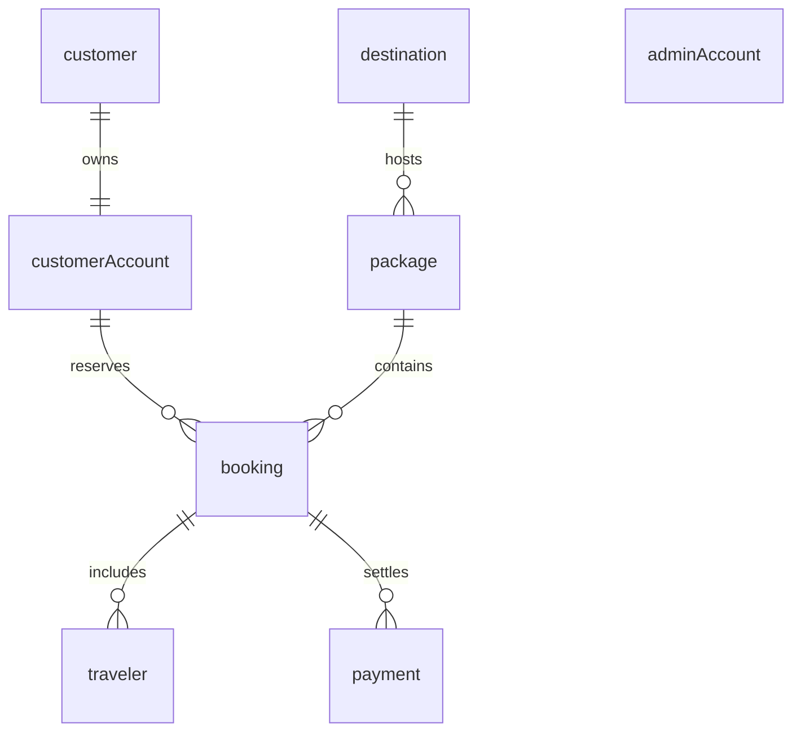

# ✈️ Travel Agency Management System (TAMS)

A desktop travel and booking management system built with Java Swing and Apache Derby. The application provides self-service exploration and booking for travelers, alongside administration tools for managing tour packages, destinations, customer accounts, and revenue.

---

## Table of Contents
1. [Overview](#overview)
2. [Features](#features)
3. [System Architecture](#system-architecture)
4. [Database Design](#database-design)
5. [Security & Technical Highlights](#security--technical-highlights)
6. [Prerequisites](#prerequisites)
7. [Installation & Setup](#installation--setup)
8. [Test Accounts](#test-accounts)
9. [Project Directory Structure](#project-directory-structure)

---

## Overview

The Travel Agency Management System (TAMS) provides an offline desktop interface for managing travel agency workflows. It pairs an Apache Derby relational database with a standardized Java Swing GUI (1000×600 main workspaces, 500×500 authentication dialogs) to handle reservations, passenger records, and sales reports without requiring internet connectivity.

---

## Features

### Traveler Portal
* **Account Registration & Login**: Account creation with validation for unique usernames and emails.
* **Browse Destinations & Packages**: Search and review available destinations, tour packages, prices, and traveler limits.
* **Booking & Checkout**: Reserve vacation packages, specify travel dates and traveler counts, and submit payment records.
* **My Bookings**: Review personal booking histories and current reservation statuses (`Pending`, `Confirmed`, `Cancelled`, `Completed`).
* **Profile Management**: View and update customer contact details directly from the dashboard.

### Admin Portal
* **Destination Management**: Add, update, and catalog travel destinations with active/inactive statuses.
* **Package Management**: Create tour packages, link them to destinations, and enforce traveler capacity thresholds.
* **Booking Management**: Review submitted customer reservations, update booking statuses, and manage records.
* **Customer Management**: Search, edit, and maintain registered customer accounts.
* **Sales & Revenue Reports**: Review transaction logs, payment methods, and revenue totals.
* **Admin Account Management**: Manage administrator credentials and roles (`Admin`, `Manager`).

---

## System Architecture

The application follows a tiered architecture separating presentation, session state, data access, and database storage:

```mermaid
flowchart TD
    subgraph UI_Layer ["Presentation Layer (Swing / AWT)"]
        UI_Screens["Screen Base Frame & View Components<br>(Homepage, Login, Dashboards, Management Forms)"]
    end

    subgraph Logic_Layer ["Application & Session Layer"]
        Session["Session State Manager<br>(Session.java)"]
        Validation["Input Sanitization & Business Rules"]
    end

    subgraph DAO_Layer ["Data Access Layer (JDBC)"]
        DAOs["Data Access Objects (DAO)<br>PreparedStatement CRUD Operations"]
        DBConn["Database Connection Manager<br>(DBConnection.java)"]
    end

    subgraph DB_Layer ["Relational Database (Apache Derby)"]
        Derby[("Apache Derby Database<br>(travel_agency on :1527)")]
    end

    UI_Screens --> Session
    UI_Screens --> Validation
    Validation --> DAOs
    DAOs --> DBConn
    DBConn --> Derby
```



---

## Database Design

The relational database schema is normalized to 3NF across 8 tables:

| Table | Primary Key | Foreign Keys | Description |
| :--- | :--- | :--- | :--- |
| `customer` | `customerID` | — | Customer personal details and unique email addresses |
| `customerAccount` | `customerAccountID` | `customerID` | Customer credentials and account status (`Active`, `Inactive`, `Suspended`) |
| `destination` | `destinationID` | — | Travel locations, countries, and descriptions |
| `package` | `packageID` | `destinationID` | Tour packages with participant limits and pricing |
| `booking` | `bookingID` | `customerAccountID`, `packageID` | Reservation details, travel dates, and status |
| `traveler` | `travelerID` | `bookingID` | Individual travelers listed under a booking |
| `payment` | `paymentID` | `bookingID` | Transaction amounts, dates, and payment methods |
| `adminAccount` | `adminAccountID` | — | Administrator accounts and system roles |



---

## Security & Technical Highlights

* **Password Hashing**: Passwords are encrypted with SHA-256 digests prior to database insertion; plain-text passwords are never stored.
* **Parameterized Queries**: All database interactions use JDBC `PreparedStatement` to guard against SQL injection.
* **Standardized GUI Layout**: Main screens use a uniform 1000×600 canvas with consistent padding, font hierarchy, and color-coded action buttons; modal auth dialogs use a standard 500×500 frame.
* **Centralized Session State**: [`Session.java`](src/main/java/common/Session.java) retains authentication context across screen transitions.
* **Component Architecture**: [`Screen.java`](src/main/java/common/Screen.java) encapsulates reusable UI factories for tables, search bars, inputs, and layout centering.

---

## Prerequisites

* **Java Development Kit (JDK)**: Version 21 LTS or later.
* **Apache NetBeans IDE**: Version 17 or higher (with Maven support).
* **Apache Derby RDBMS**: Java DB included or configured in NetBeans.

---

## Installation & Setup

### 1. Clone the Repository
```bash
git clone https://github.com/abenadigor/Travel-Agency-Management-System.git
cd Travel-Agency-Management-System
```

### 2. Start Java DB in NetBeans
1. In NetBeans, open the **Services** tab in the left sidebar.
2. Expand **Databases** $\rightarrow$ Right-click **Java DB** $\rightarrow$ Click **Start Server**.
3. Right-click **Java DB** $\rightarrow$ Click **Create Database...**:
   * **Database Name**: `travel_agency`
   * **User Name**: `root`
   * **Password**: `password`

Connection URL:
```text
jdbc:derby://localhost:1527/travel_agency;create=true
```

### 3. Initialize Schema
Open and run the SQL script in NetBeans (or execute via SQL Editor):
```text
src/main/java/Database-Script-Apache-Derby.sql
```

### 4. Seed Initial Data
Run [`src/main/java/common/DatabaseSeeder.java`](src/main/java/common/DatabaseSeeder.java) in NetBeans (<kbd>Shift</kbd> + <kbd>F6</kbd>) to insert default admin and customer accounts.

### 5. Run the Application
Run the project (<kbd>F6</kbd>) or launch [`src/main/java/main/Main.java`](src/main/java/main/Main.java).

---

## Test Accounts

Default seed credentials generated by `DatabaseSeeder.java`:

### Administrator Accounts
| Username | Password | Role | Permissions |
| :--- | :--- | :--- | :--- |
| `admin` | `admin123` | **Admin** | Full system and user administration |
| `manager` | `manager123` | **Manager** | Operational management and reporting |

### Customer Accounts
| Username | Password | Customer Name | Email |
| :--- | :--- | :--- | :--- |
| `juan` | `juan123` | Juan Dela Cruz | `juan@example.com` |
| `maria` | `maria123` | Maria Clara | `maria@example.com` |

---

## Project Directory Structure

```text
Travel-Agency-Management-System/
├── src/
│   ├── main/
│   │   ├── java/
│   │   │   ├── common/
│   │   │   │   ├── DBConnection.java       # Centralized JDBC connection factory
│   │   │   │   ├── DatabaseSeeder.java     # Database seeder for default accounts
│   │   │   │   ├── Screen.java             # Base JFrame template & UI helper components
│   │   │   │   └── Session.java            # Global user authentication & session state
│   │   │   ├── dao/
│   │   │   │   ├── AdminAccountDAO.java
│   │   │   │   ├── BookingDAO.java
│   │   │   │   ├── CustomerAccountDAO.java
│   │   │   │   ├── CustomerDAO.java
│   │   │   │   └── DestinationDAO.java
│   │   │   ├── model/
│   │   │   │   ├── AdminAccount.java
│   │   │   │   ├── Booking.java
│   │   │   │   ├── customer.java
│   │   │   │   ├── CustomerAccount.java
│   │   │   │   ├── Destination.java
│   │   │   │   ├── Payment.java
│   │   │   │   ├── Traveler.java
│   │   │   │   └── TravelPackage.java
│   │   │   ├── ui/
│   │   │   │   ├── admin/                  # Administrative screens
│   │   │   │   │   ├── AdminDashboard.java
│   │   │   │   │   ├── AdminManagement.java
│   │   │   │   │   ├── BookingManagement.java
│   │   │   │   │   ├── CustomerManagement.java
│   │   │   │   │   ├── DestinationManagement.java
│   │   │   │   │   ├── PackageManagement.java
│   │   │   │   │   └── SalesManagement.java
│   │   │   │   ├── customer/               # Customer screens
│   │   │   │   │   ├── BookingScreen.java
│   │   │   │   │   ├── CustomerDashboard.java
│   │   │   │   │   ├── CustomerProfile.java
│   │   │   │   │   ├── MyBookings.java
│   │   │   │   │   └── PaymentScreen.java
│   │   │   │   ├── AdminLogin.java
│   │   │   │   ├── BrowseDestinations.java
│   │   │   │   ├── BrowsePackages.java
│   │   │   │   ├── CustomerLogin.java
│   │   │   │   ├── CustomerRegister.java
│   │   │   │   └── Homepage.java
│   │   │   ├── main/
│   │   │   │   └── Main.java               # Application bootstrap entry point
│   │   │   └── Database-Script-Apache-Derby.sql
│   └── test/                               # Test source files
├── nbactions.xml                           # NetBeans custom run/debug actions
├── pom.xml                                 # Maven dependencies and build configuration
└── README.md                               # Project documentation
```
